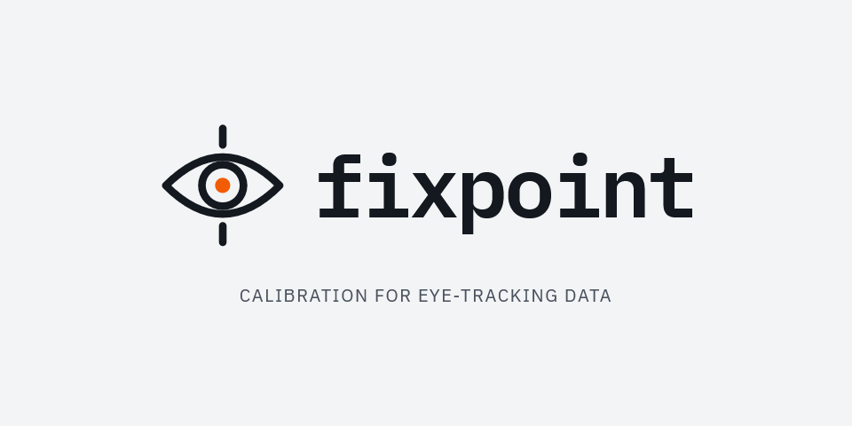
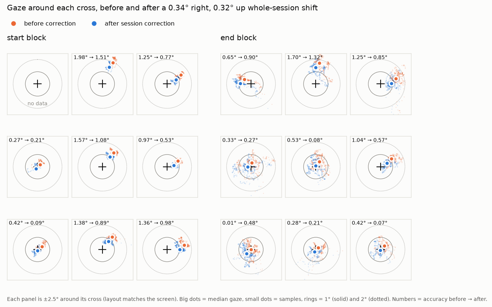
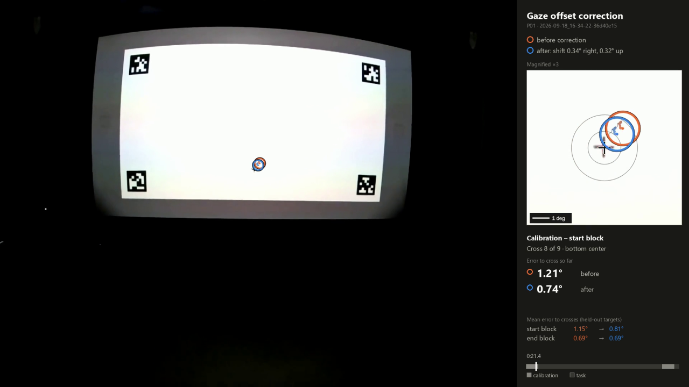

<p align="center">
  <picture>
    <source media="(prefers-color-scheme: dark)" srcset="docs/brand/fixpoint-lockup-dark.png">
    <source media="(prefers-color-scheme: light)" srcset="docs/brand/fixpoint-lockup-light.png">
    
  </picture>
</p>

<p align="center">
  <b>Calibrate eye-tracking data against known fixation targets.</b><br>
  Validation and offset correction for Pupil Labs Neon gaze on a projected screen.
</p>


fixpoint measures how accurately Neon gaze lands on a 3×3 grid of fixation crosses
shown at the start and end of an experiment, estimates any systematic shift that
persists over the whole session (e.g. gaze always a little up and to the right), and
produces corrected gaze data, a report, and an optional before/after video.

It is built for experiments where people look at a projected screen marked with
AprilTags, and you want to know *where on the screen* they looked.





---

## Contents

- [How the calibration works](#how-the-calibration-works)
- [Install](#install)
- [Try it on the example recording](#try-it-on-the-example-recording)
- [Use it on your own experiment](#use-it-on-your-own-experiment)
- [Outputs](#outputs)
- [Reading the results](#reading-the-results)
- [Applying the session correction](#applying-the-session-correction)
- [Method details](#method-details)
- [Limitations and troubleshooting](#limitations-and-troubleshooting)
- [Example data](#example-data)
- [Project layout and tests](#project-layout-and-tests)

---

## How the calibration works

1. At the **start** and **end** of the session, the participant looks at 9 red crosses
   shown **one at a time** (top-left → bottom-right, ~3 s each). Four AprilTags in the
   slide corners let fixpoint find the screen in the Neon scene video.
2. Assuming the participant really looks at each cross, any difference between gaze
   and cross is tracker error. fixpoint measures it per cross in **degrees of visual
   angle** — using the scene camera's calibration, so you don't need to measure the
   screen or viewing distance.
3. It then fits **one constant shift for the whole session** from both blocks, checks
   whether that shift is consistent and actually helps on crosses it was not fitted to,
   and writes corrected gaze.

Neon itself is calibration-free; this is a *validation* plus an optional *post-hoc
offset correction* — the same kind of correction as Neon's built-in offset correction,
but estimated from 18 targets instead of one, and checked.

## Install

You need [conda](https://docs.conda.io/en/latest/miniconda.html) (Anaconda or Miniconda)
and git. Then, from a terminal:

```
git clone https://github.com/CamHickling/FixPoint.git
cd FixPoint
conda env create -f environment.yml
conda activate fixpoint
fixpoint --help
```

This creates an isolated `fixpoint` environment (Python 3.11) and installs the
`fixpoint` command. Everything needed — including the video encoder — comes from pip;
no system packages are required. Tested on Windows 11; macOS/Linux should work the same.

> Without conda: `python -m venv .venv`, activate it, then `pip install -e .[test]`.

## Try it on the example recording

```
conda activate fixpoint
fixpoint examples/pilot/neon_export
```

About 40 seconds later, open `output/2026-09-18_16-34-22-36d40e15/report.html` in a
browser. Add `--video` to also render the before/after video (takes about real time,
~6 minutes for this recording):

```
fixpoint examples/pilot/neon_export --video
```

## Use it on your own experiment

### 1. Show the calibration slides

The slides are in [`fixpoint/slides/`](fixpoint/slides) (1920×1080):

| file | shows |
|---|---|
| `calibration_target_1_1_top_left.png` … `calibration_target_9_9_bottom_right.png` | one cross each, at 20 / 50 / 80 % of the width and height |
| `reference_all_9_targets.png` | all nine crosses — for instructions/illustration only, not analysed |

Protocol, at the **start and the end** of the session:

- show slides 1 → 9 **in order**, each for about **3 s**, full screen;
- tell participants to look at the centre of each cross until it moves;
- **start the Neon recording a few seconds before** the first cross (gaze only becomes
  available ~2 s after recording starts);
- keep the calibration and task in the **same recording**.

**Tags.** Calibration slides use tag36h11 IDs 0–3. Your task slides may reuse some of
those IDs, but each task frame must show at least one tag that is *not* 0–3 (the pilot's
task slides use IDs 1, 2 and 4–9), otherwise task frames would be mistaken for
calibration frames.

**Using your own slides** (different resolution, positions or tags): put them in a
folder with the same file naming (`calibration_target_<n>_<n>_<name>.png`, red crosses,
AprilTags tag36h11) and pass `--slides that/folder`. Cross and tag positions are read
from the images automatically.

### 2. Mark each cross in PsychoPy (recommended)

Without events fixpoint works out the timing from the video, which is good but not
perfect (see [limitations](#limitations-and-troubleshooting)). With events the timing is
exact. Install `pupil-labs-realtime-api` in the PsychoPy environment and send an event
right after each cross appears:

```python
import time
from pupil_labs.realtime_api.simple import discover_one_device

device = discover_one_device()
# Phone and PC clocks differ: measure the offset once, before the calibration.
offset_ns = int(device.estimate_time_offset().time_offset_ms.mean * 1e6)

def mark(name):
    device.send_event(name, event_timestamp_unix_ns=time.time_ns() - offset_ns)

for k, slide in enumerate(calibration_slides, start=1):   # your 9 ImageStims, in order
    slide.draw()
    win.flip()
    mark(f"cal_target_{k}")
    core.wait(3.0)
mark("cal_end")
```

fixpoint recognises `cal_target_<n>` (also `calibration_target_<n>` and an `_on`
suffix). Each cross ends at the next event, or after the typical cross duration.

### 3. Export from Pupil Cloud

For each recording, download **Timeseries Data + Scene Video** and unzip it. Each
recording folder must contain `gaze.csv`, `events.csv`, `info.json`,
`scene_camera.json`, `world_timestamps.csv` and the scene video `.mp4`. No Pupil Cloud
enrichments are needed.

### 4. Run

```
fixpoint path/to/exports --out results
```

`path/to/exports` can be a single recording folder or any folder containing many —
every Neon export underneath is processed, and a recording that fails does not stop the
others.

| option | default | meaning |
|---|---|---|
| `--out` | `output` | where results are written |
| `--slides` | bundled slides | folder with your calibration slides |
| `--skip` | `0.5` | seconds after each cross appears that are ignored while the eye travels to it |
| `--video` | off | also render the before/after video |

## Outputs

Per recording, in `<out>/<recording name>/`:

| file | contents |
|---|---|
| **`report.html`** | everything below, with figures — start here |
| `before_after_correction.png` | the before/after figure shown at the top of this README |
| `gaze_before_after.mp4` | with `--video`: the whole session with both gaze positions |
| `blocks.csv` | per block (start / end): accuracy, offset direction, precision, data loss |
| `targets.csv` | per block × cross: every metric, in degrees and slide pixels |
| `drift.csv` | per cross: change in offset from start to end |
| `session_offset.json` | the session shift, its checks and flags, and the value to enter in Pupil Cloud |
| `session_offset_targets.csv` | per cross: accuracy raw / corrected / corrected with a held-out fit |
| `corrected/gaze.csv`, `corrected/fixations.csv` | the export's files with the shift removed — same columns |
| `corrections.csv`, `corrections_per_target.csv` | comparison of offset vs affine corrections |
| `samples.csv` | every gaze sample used, mapped onto the slide |
| `presentations.csv` | when each cross was on screen, and how that was determined |
| `frames.csv` | per video frame: tags seen, tag-fit error, redness of each cross |
| `summary.json` | recording info, notes and block summary |

Across all recordings: `<out>/all_recordings_blocks.csv`, one row per recording × block,
including the session shift and whether it is recommended.

Coordinates: **slide pixels** have the origin at the top-left of the slide, y pointing
down. **Offsets in degrees** are positive when gaze is *right of* / *above* the cross.

## Reading the results

| metric | meaning |
|---|---|
| **accuracy** | angle between the *median* gaze and the cross — systematic error |
| **offset h / v** | the direction of that error (+ = right / up) |
| **precision (robust SD)** | spread of gaze around its own median, ignoring stray samples |
| precision (SD), RMS-S2S | classic spread, and sample-to-sample jitter |
| **data loss** | share of expected samples missing (blinks, not worn, tags not visible) |
| % within 1° / 2° | share of samples within that distance of the cross |
| timing source | `event`, `video`, `video_extended` (onset extended) or `inferred` (see below) |

As a rough guide for Neon on a large screen: under ~1° mean accuracy is good, 1–2° is
typical, above 2° deserves a look. What matters is accuracy relative to **your** areas of
interest: an error of 1° is small for a region spanning 10° and large for one spanning 2°.
The report shows the projected slide size in degrees to help with this.

## Applying the session correction

The **session shift** is the median gaze–cross shift over all usable crosses in both
blocks, measured in raw scene-camera pixels — the same space as Neon's own offset
correction. The report flags it as *use with care* when:

- fewer than two-thirds of crosses are shifted the same way (bias not consistent),
- the start and end shifts differ by more than 0.5° (the headset probably moved), or
- it does not improve crosses it was not fitted to.

Whether to apply a flagged correction is your call — the report shows the evidence
(per block, per cross, held-out). Two ways to apply it:

**A — in Pupil Cloud / the Companion app.** Enter `new_device_gaze_offset_px` (also in
the report) as the recording's gaze offset, re-run your enrichments (e.g. Marker
Mapper), re-export and re-run fixpoint: the remaining shift should now be close to zero.
fixpoint assumes Neon *adds* the offset to gaze; if the shift doubles instead, use
`current − (new − current)`.

**B — locally.** Use `corrected/gaze.csv` and `corrected/fixations.csv` in place of the
export's files. Pixel coordinates are shifted and azimuth/elevation recomputed; all
other columns are unchanged. Note that Pupil Cloud enrichments (e.g. Marker Mapper)
were computed from uncorrected gaze, so any mapping onto the screen must be redone from
the corrected files.

## Method details

1. **Slides.** Tag corners and cross centres are read from the slide images, so all
   positions are exact slide pixels.
2. **Finding the screen.** A sparse pass over the scene video finds when only the
   calibration tags are visible; those stretches are then processed frame by frame.
   Tag corners are undistorted with the camera's intrinsics (`scene_camera.json`) and a
   homography maps the scene camera onto the slide (typical corner error < 1 slide px).
3. **Timing of each cross.** From `cal_target_<n>` events if present. Otherwise each
   cross position is checked for red in every frame; crosses the camera cannot see are
   placed using the known order and slide duration (`inferred`), and crosses seen for
   only part of a slide are extended back to a full slide (`video_extended`).
4. **Errors in degrees.** Gaze and cross are both converted into viewing directions of
   the scene camera (the cross via the inverse homography of that frame), so errors are
   true visual angles and head movement is handled frame by frame. The first `--skip`
   seconds of each cross are ignored; blinks, not-worn samples and gaze more than 100 ms
   from a mapped frame count as data loss.
5. **Correction models.** Constant offset and affine models are evaluated leave-one-out
   within each block and by fitting on the start and testing on the end block. The
   session shift is the constant model fitted on both blocks.

The gaze offset already set in the Companion app (`gaze_offset` in `info.json`) is part
of the exported gaze; the report shows it so you know what was measured.

## Limitations and troubleshooting

- **A constant shift only.** If the start and end blocks disagree (flag), the headset
  probably moved during the session; a single correction is then a compromise.
- **Projector hotspot.** In the pilot the top-centre cross was washed out in the scene
  video (though visible to the participant), so its timing had to be inferred. Thicker
  or darker crosses, or PsychoPy events, avoid this.
- **No data for the first cross.** Neon gaze starts ~2 s after recording begins — start
  recording earlier.
- **"Calibration slides were never visible".** Check that the tags are tag36h11 IDs 0–3
  (or match your `--slides`), that they are large and sharp enough in the scene video,
  and that the slides were shown in this recording.
- **Neon only.** fixpoint reads Neon's Pupil Cloud export format.
- **Parallax** between eye and scene camera is ignored; it is negligible at projector
  distances (metres) and the calibration and task are at the same distance anyway.

## Example data

`examples/pilot/` is a real pilot session (recorded 2026-09-18, ~6 min): calibration
block, 91 task trials of street-scene images, calibration block.

| folder | contents |
|---|---|
| `neon_export/` | Pupil Cloud *Timeseries Data + Scene Video* export — what fixpoint reads |
| `cloud_marker_mapper/` | Pupil Cloud *Marker Mapper* export of the task section — not used by fixpoint, kept for reference |

For sharing, the wearer name was replaced with `P01`, the scene video's **audio track
was removed**, and the video was re-encoded (45 MB instead of 169 MB, same resolution,
frame rate and frame count). Results match the original video to within 0.03° per cross.

Results for this recording: mean accuracy 1.15° (start) and 0.69° (end); session shift
0.34° right and 0.32° up (88 % of crosses shifted right, 100 % up). Judged on held-out
crosses, the shift improves the start block to 0.81° and leaves the end block unchanged
(0.69°). It is flagged *use with care* because the start and end shifts differ by
~0.7°: the bias was larger at the start than at the end.

## Project layout and tests

```
fixpoint/            the package (run as `fixpoint` or `python -m fixpoint`)
  layout.py          read slides: tag corners and cross positions
  recording.py       load a Neon export; camera undistortion
  mapping.py         find the slides in the scene video; scene→slide homographies
  segmentation.py    when each cross was shown (events, video, inferred)
  analysis.py        accuracy, precision, drift, correction models
  session_offset.py  whole-session shift, checks, corrected gaze files
  report.py          figures and HTML report
  video.py           before/after video
  pipeline.py        runs everything for one recording
  slides/            the calibration slides
examples/pilot/      anonymised example recording
tests/               unit tests and an end-to-end test on the example
docs/                images for this README
  brand/             logo lockups (light/dark) and the GitHub social preview
```

Run the tests (≈40 s; the end-to-end test scans the example video):

```
conda activate fixpoint
pytest
```
